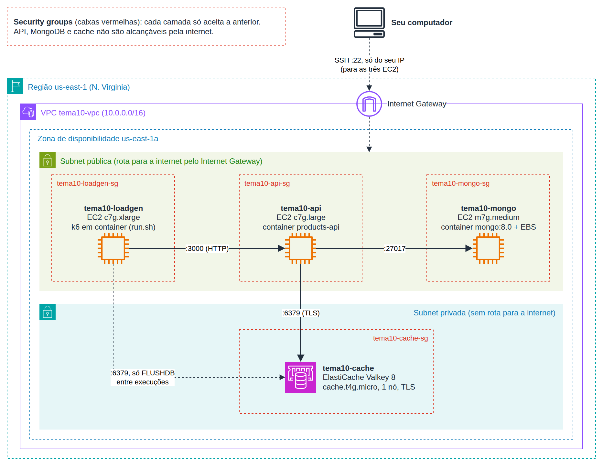
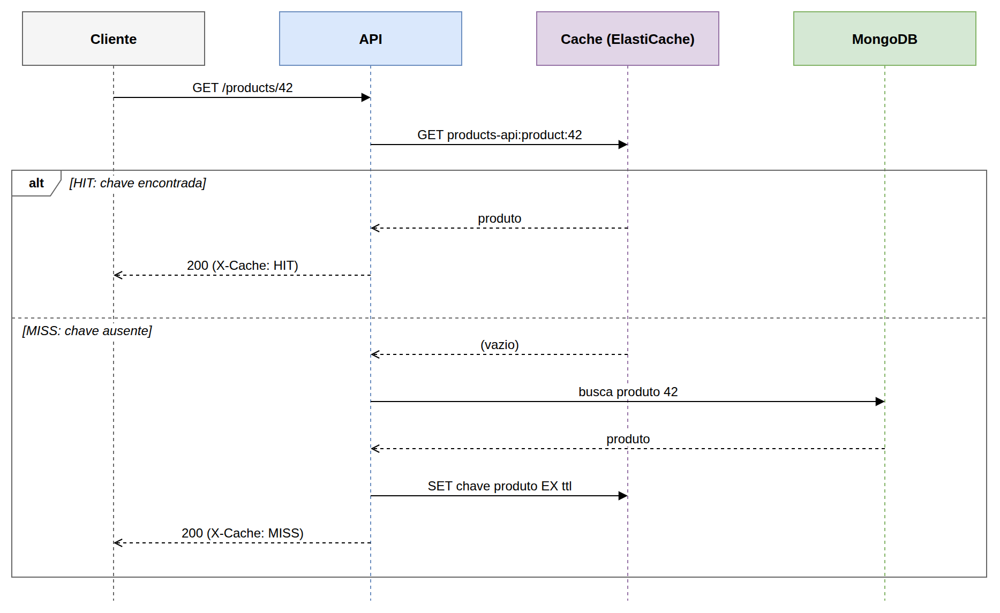
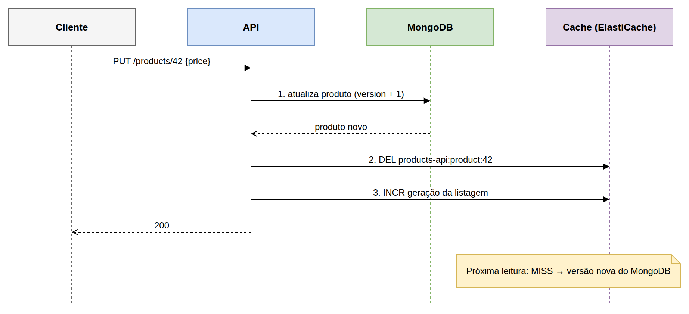
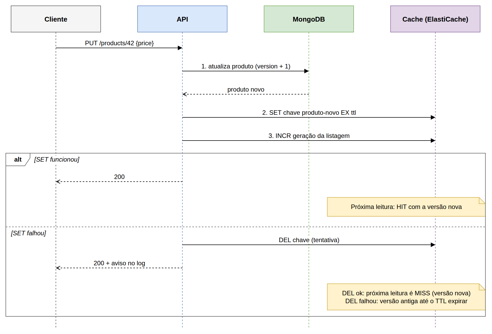

# Guia para a equipe do relatório

Este documento reúne o que é preciso para escrever o relatório do **Tema 10 — Cache distribuído com
Amazon ElastiCache** sem ler o código: arquitetura, stack e ferramentas, como cada estratégia
funciona, parâmetros de configuração, como as medições foram feitas, onde estão os dados e o que cada
número significa.

Os **números** do relatório vêm das medições na AWS, feitas pela equipe de deploy com o
[guia de deploy](deploy-aws.md). Elas ficam em `loadtest/results-aws/` (seção 9 deste documento).
Aqui está tudo o que **não muda** entre execuções: o desenho do sistema e o método.

## Sumário

1. [Mapa: o que o PDF pede e onde está](#1-mapa-o-que-o-pdf-pede-e-onde-está)
2. [Visão geral e arquitetura](#2-visão-geral-e-arquitetura)
3. [Stack e ferramentas](#3-stack-e-ferramentas)
4. [Componentes da API](#4-componentes-da-api)
5. [Dados](#5-dados)
6. [Estratégias de cache (com diagramas de leitura e escrita)](#6-estratégias-de-cache)
7. [Parâmetros de configuração](#7-parâmetros-de-configuração)
8. [Metodologia de medição](#8-metodologia-de-medição)
9. [Onde estão os dados e como lê-los](#9-onde-estão-os-dados-e-como-lê-los)
10. [Comportamento em falhas](#10-comportamento-em-falhas)
11. [Custos](#11-custos)
12. [Elementos para a interpretação de trade-offs](#12-elementos-para-a-interpretação-de-trade-offs)
13. [Limitações conhecidas](#13-limitações-conhecidas)
14. [Glossário](#14-glossário)

---

## 1. Mapa: o que o PDF pede e onde está

### Implementação e demonstração

| # | Item do PDF | Onde está explicado | Evidência (dados) |
|---|---|---|---|
| 1 | API e banco com leituras repetidas e atualizações; versão sem cache (baseline) | [4](#4-componentes-da-api), [6.1](#61-none-baseline-sem-cache) | execuções `none-*` em `results-aws/` |
| 2 | Cache-aside com chave e TTL explícitos; medir acertos, falhas, latência e carga na fonte | [6.2](#62-cache-aside-lazy-loading), [7](#7-parâmetros-de-configuração), [8](#8-metodologia-de-medição) | execuções `cache-aside-*`; colunas `hit_rate`, `p50/p95/p99_ms`, `db_reads_per_read` |
| 3 | Write-through; ordem de gravação e comportamento se a atualização do cache falhar | [6.3](#63-write-through), [10](#10-comportamento-em-falhas) | execuções `write-through-*`; saída do cenário 11.6 do guia de deploy |
| 4 | Atualizar dados e demonstrar invalidação/expiração e a janela de desatualização | [6.4](#64-janela-de-desatualização), [8.4](#84-teste-da-janela-de-desatualização) | `staleness-runs.csv`, `staleness.png`, `invalidation-*.txt` |
| 5 | Carga com e sem cache, aumentando clientes; percentis, throughput, hit rate e custos | [8](#8-metodologia-de-medição), [11](#11-custos) | `read-runs.csv` e gráficos `latency/throughput/hit-rate/db-load-*.png` |

### Entregáveis

| Entregável | Onde |
|---|---|
| Código | repositório (`src/`, `loadtest/`, `scripts/`) |
| Diagrama de leitura/escrita das duas estratégias | [6.2](#62-cache-aside-lazy-loading) e [6.3](#63-write-through); imagens PNG em `docs/diagrams/` |
| Parâmetros de TTL | [7](#7-parâmetros-de-configuração) |
| Dados brutos e gráficos/tabelas comparáveis | [9](#9-onde-estão-os-dados-e-como-lê-los) |
| Exemplo de invalidação | `loadtest/results-aws/invalidation-*.txt` ([9](#9-onde-estão-os-dados-e-como-lê-los)) |
| Interpretação de trade-offs | [12](#12-elementos-para-a-interpretação-de-trade-offs) |

### "O que estudar" e "Operação"

| Tema do PDF | Onde |
|---|---|
| Fonte de verdade, chaves, TTL, hit/miss, eviction, memória e rede | [6](#6-estratégias-de-cache), [7](#7-parâmetros-de-configuração), [14](#14-glossário) |
| Redis OSS × Memcached × Valkey | [12.6](#126-valkey--redis-oss--memcached) |
| Concorrência de atualização | [6.5](#65-concorrência-e-atomicidade) |
| ElastiCache na rede privada, parâmetros de nós | [2.2](#22-infraestrutura-na-aws), [7.2](#72-elasticache-parâmetros-do-nó) |
| Métricas CloudWatch | [8.6](#86-métricas-do-cloudwatch) |
| Disponibilidade e custos | [12.7](#127-disponibilidade), [11](#11-custos) |

### Pontos de atenção do PDF

| Ponto | Como foi tratado |
|---|---|
| Não medir apenas a segunda execução (quente); registrar warm-up | Warm-up explícito de 10 s, descartado das métricas ([8.2](#82-warm-up-e-reinício-das-métricas)), e uma execução **fria** sem warm-up para comparar (`results-aws-cold/`) |
| Registrar distribuição de chaves e quantidade de dados | Distribuições `hotset` (80/20) e `uniform`; 100 000 produtos com seed determinístico ([5](#5-dados)); tudo registrado em `ENVIRONMENT.md` |
| Diferenciar ganho de cache da capacidade do banco | Baseline sem cache, consultas ao Mongo por leitura e CPU do Mongo no CloudWatch ([12.3](#123-ganho-do-cache--capacidade-do-banco)) |
| Não assumir que write-through dá atomicidade | [6.5](#65-concorrência-e-atomicidade) e [10](#10-comportamento-em-falhas) |

---

## 2. Visão geral e arquitetura

Uma **API REST de produtos** com MongoDB como fonte de verdade e Redis/ElastiCache como cache.
A **estratégia de cache** é escolhida na inicialização da API por uma variável de ambiente
(`CACHE_STRATEGY`): `none`, `cache-aside` ou `write-through`. Assim as três versões são **o mesmo
programa**, medidas nas mesmas máquinas, com os mesmos dados e a mesma carga. Só a política de cache
muda, o que torna a comparação justa.

```
Gerador de carga (k6) → API (Node.js/Express) → Cache (ElastiCache) → MongoDB (fonte de verdade)
```

É exatamente a arquitetura mínima do PDF: *clientes → API → cache → banco*, com um gerador de carga
de distribuição conhecida e uma rotina que altera valores (o teste de desatualização).

### 2.1 Fluxo de uma requisição dentro da API

```
HTTP → rotas → controller → estratégia de cache ─┬→ repository   → MongoDB
                                                  └→ cacheService → Redis / ElastiCache
```

### 2.2 Infraestrutura na AWS



- **Região `us-east-1`, uma única zona de disponibilidade (`us-east-1a`):** todas as máquinas na
  mesma AZ, para a latência de rede ser mínima e igual em todos os testes.
- **VPC própria** com uma subnet **pública** (as três EC2) e uma **privada** (o ElastiCache, sem
  acesso à internet: "ElastiCache acessível na rede privada", como pede o PDF).
- **Security groups encadeados:** o gerador só alcança a API (porta 3000), a API só alcança o MongoDB
  (27017) e o cache (6379), e o gerador alcança o cache apenas para esvaziá-lo entre execuções.
  Nada além do SSH é acessível pela internet.
- **Cada serviço numa máquina separada:**
  - **MongoDB em EC2 própria:** a capacidade do banco fica conhecida e isolada, o que permite separar
    o ganho do cache do limite do banco;
  - **gerador de carga em EC2 própria, dentro da VPC:** não disputa CPU com a API e não mede a
    latência da internet.

| Máquina | Tipo | Papel |
|---|---|---|
| `tema10-api` | EC2 `c7g.large` (2 vCPU, 4 GiB, ARM Graviton) | API em container Docker |
| `tema10-mongo` | EC2 `m7g.medium` (1 vCPU, 4 GiB) + disco EBS gp3 20 GiB | MongoDB 8.0 em container Docker |
| `tema10-loadgen` | EC2 `c7g.xlarge` (4 vCPU, 8 GiB) | k6 (gerador de carga) em container Docker |
| `tema10-cache` | ElastiCache Valkey 8, `cache.t4g.micro` (0,5 GiB), 1 nó | Cache |

> Confirme os tipos e versões reais no arquivo `loadtest/results-aws/ENVIRONMENT.md`, preenchido
> pela equipe de deploy. Se algo mudou no dia, o arquivo vale mais que esta tabela.

---

## 3. Stack e ferramentas

### 3.1 Aplicação

| Componente | Tecnologia | Papel |
|---|---|---|
| Runtime | **Node.js** (imagem `node:26-alpine`) | Executa a API |
| Framework HTTP | **Express 5** | Rotas e respostas HTTP |
| Validação de entrada | **express-validator** | Rejeita entradas inválidas (400) |
| Acesso ao banco | **Mongoose 9** | Driver/ODM do MongoDB |
| Cliente do cache | **ioredis** | Cliente Redis; fala também com Valkey/ElastiCache, com TLS |
| Banco (fonte de verdade) | **MongoDB 8.0** | Guarda os produtos |
| Cache local (desenvolvimento) | **Redis 7.4** (container) | Substitui o ElastiCache na máquina do desenvolvedor |
| Cache na AWS | **Amazon ElastiCache, engine Valkey 8** | Cache gerenciado na rede privada |

### 3.2 Ferramentas de execução, medição e análise

| Ferramenta | Para quê |
|---|---|
| **Docker** e **Docker Compose** | Empacota e executa a API, o MongoDB, o k6 e o gerador de gráficos. O mesmo container roda localmente e na AWS |
| **k6** (Grafana, imagem `grafana/k6:1.3.0`) | Gerador de carga: simula N clientes simultâneos e mede latência (percentis) do ponto de vista do cliente |
| **Endpoint `GET /metrics` da própria API** | Conta acertos, falhas e consultas ao MongoDB (o que só a aplicação vê) |
| **redis-cli** (em container) | Esvazia o cache entre execuções |
| **Python 3.12 + matplotlib 3.9.2** (em container) | Gera as tabelas CSV e os gráficos a partir dos resultados |
| **Amazon CloudWatch** | Métricas da infraestrutura: CPU das máquinas, hits/misses, memória e conexões do cache |
| **draw.io** | Diagrama da arquitetura |

### 3.3 Serviços da AWS usados

| Serviço | Uso |
|---|---|
| **EC2** | Três máquinas virtuais: API, MongoDB e gerador de carga |
| **EBS** | Disco das máquinas (dados do MongoDB) |
| **VPC** | Rede privada, subnets, Internet Gateway e security groups |
| **ElastiCache** | Cache gerenciado (Valkey) |
| **CloudWatch** | Métricas de infraestrutura |
| **Billing / Cost Explorer** | Custo real das medições |

---

## 4. Componentes da API

| Camada | Responsabilidade |
|---|---|
| **Rotas + validação** | Definem os endpoints e rejeitam entradas inválidas antes de chegar à lógica |
| **Controller** | Traduz para HTTP: códigos de status e o cabeçalho `X-Cache` |
| **Estratégia de cache** (padrão de projeto *Strategy*) | Decide **quando** ler do cache, do banco, gravar e invalidar. Uma implementação por estratégia, todas com a mesma interface |
| **cacheService** | Única camada que fala com o Redis: serialização JSON, TTL, prefixo das chaves e tratamento de falhas (nunca derruba a requisição) |
| **Repository** | Única camada que fala com o MongoDB |
| **Métricas** | Contadores expostos em `GET /metrics` |

O write-through **herda** a leitura do cache-aside e muda só as escritas. Isso reflete a recomendação
da AWS de combinar write-through com lazy loading (seção 6.3).

### 4.1 Endpoints

| Método | Rota | Descrição |
|---|---|---|
| `GET` | `/products/:id` | Um produto (é a operação medida no teste de carga) |
| `GET` | `/products?page=&limit=` | Listagem paginada (também com cache) |
| `POST` | `/products` | Cria produto |
| `PUT` | `/products/:id` | Atualiza produto (incrementa `version`) |
| `DELETE` | `/products/:id` | Remove produto |
| `GET` | `/health` | Estado da API e das dependências |
| `GET` | `/metrics` | Contadores de cache e banco |
| `POST` | `/metrics/reset` | Zera os contadores (usado após o warm-up) |

Toda leitura responde com o cabeçalho **`X-Cache`**:
- `HIT`: veio do cache;
- `MISS`: não estava no cache, veio do MongoDB e foi guardado;
- `BYPASS`: o cache não foi usado (estratégia `none` ou cache fora do ar).

---

## 5. Dados

**Entidade:** produto.

| Campo | Conteúdo |
|---|---|
| `productId` | Número sequencial `1..N`: o gerador de carga escolhe ids com distribuição conhecida |
| `name`, `category`, `price`, `stock` | Dados do produto (8 categorias) |
| `description` | Texto de **tamanho fixo (200 caracteres)**, para todos os valores em cache terem tamanho parecido |
| `version` | Começa em 1 e aumenta a cada atualização. É o que torna **visível** um dado desatualizado: se o cache devolve `version` menor que a do banco, o valor está velho |

**Volume:** **100 000 produtos** nas medições da AWS (confirme em `ENVIRONMENT.md`).

**Seed determinístico:** os produtos são gerados por um gerador pseudoaleatório com semente fixa.
A mesma quantidade sempre gera exatamente os mesmos dados, então as execuções são reproduzíveis.

**Distribuições de acesso (chaves):**

| Nome | Regra | Por quê |
|---|---|---|
| `hotset` (80/20) | 80% das leituras vão para os primeiros 20% dos ids; 20% para os outros 80% | Imita um catálogo real, em que poucos produtos são muito acessados |
| `uniform` | Qualquer id com a mesma probabilidade | Pior caso para o cache; mostra o efeito da distribuição |

Com 100 000 chaves a distribuição faz diferença no hit rate. Com poucas chaves (ex.: 10 000), todas
entram no cache em segundos e as duas distribuições ficam iguais. Por isso o volume foi aumentado em
relação aos testes locais.

---

## 6. Estratégias de cache

### 6.1 `none` (baseline sem cache)

Toda leitura e escrita vai direto ao MongoDB (`X-Cache: BYPASS`); nenhuma conexão com o cache é
criada. Mede a capacidade de **API + banco** sozinhos: é a referência contra a qual o ganho do cache é
medido.

### 6.2 Cache-aside (lazy loading)

**Chave:** `products-api:product:<id>` (ex.: `products-api:product:42`).
**Valor:** o produto em JSON. **TTL:** `CACHE_TTL_SECONDS` (60 s nas medições de carga).

**Leitura:** consulta o cache. Se estiver lá (HIT), responde sem tocar no banco. Se não estiver
(MISS), lê do banco, grava no cache com TTL e responde. Produtos inexistentes não são guardados (sem
"cache negativo").



**Escrita:** grava no banco **primeiro** e depois **apaga** a chave do cache (`DEL`, invalidação). A
próxima leitura será um MISS e trará o valor novo.



**Modo sem invalidação** (`CACHE_INVALIDATE_ON_WRITE=false`): a escrita não apaga a chave. As
leituras continuam devolvendo o valor velho **até o TTL expirar**. Este modo existe só para
**demonstrar e medir** a janela de desatualização (item 4 do PDF).

**Listagem paginada:** cada página é guardada numa chave que inclui um **número de geração**
(`products-api:products:list:v<geração>:p<página>:l<limite>`). Toda escrita incrementa a geração com
um único comando (`INCR`), e todas as páginas antigas deixam de ser lidas de uma vez. O contador de
geração não tem TTL. É por isso que a política de eviction precisa ser `volatile-*` (seção 7.2). Os
testes de carga medem só a leitura de produto individual.

### 6.3 Write-through

A leitura é **igual** à do cache-aside (mesmo diagrama de leitura da seção 6.2). A diferença está na escrita: em vez de apagar a chave, a API
**grava o valor novo** no cache, e a próxima leitura já é um HIT com a versão nova. Write-through
sozinho define só a escrita. Combinado com lazy loading e TTL, é o padrão completo recomendado pela
AWS: dados nunca escritos desde que o cache começou ainda são carregados num MISS, e chaves que
ninguém lê expiram sozinhas.

**Ordem de gravação** (item 3 do PDF):

| # | Passo | Se falhar |
|---|---|---|
| 1 | Grava no **MongoDB** (fonte de verdade) | Erro para o cliente; o cache não é tocado |
| 2 | `SET` da chave com o valor novo e **TTL renovado** | Falha parcial (abaixo) |
| 3 | `INCR` da geração da listagem | Páginas da listagem podem ficar velhas até o TTL |

**Por que o banco primeiro:** se o cache fosse gravado primeiro e o banco falhasse, os leitores
receberiam um valor que nunca existiu na fonte de verdade.

**Se a atualização do cache falhar** (banco gravado, `SET` falhou):
- a API tenta **apagar** a chave (`DEL`), para a próxima leitura buscar o valor novo no banco, e
  registra um aviso no log;
- se o `DEL` também falhar (cache fora do ar), o valor antigo pode ser servido **até o TTL expirar**;
- a escrita em si **não falha**: o cliente recebe 200, porque o banco, que é a fonte de verdade, foi
  gravado.



Em `POST`, o produto novo também é gravado no cache, e a primeira leitura já é um HIT. Em `DELETE`,
a chave é apagada, como no cache-aside.

### 6.4 Janela de desatualização

É o tempo entre uma escrita no banco e o momento em que os leitores passam a ver o valor novo.

| Estratégia | Janela esperada | Por quê |
|---|---|---|
| Cache-aside **com** invalidação | ~0 | O `DEL` faz a próxima leitura ir ao banco |
| Cache-aside **sem** invalidação | ≈ TTL | O valor velho fica até expirar |
| Write-through | ~0 | O valor novo é gravado no cache na própria escrita |
| Qualquer estratégia, com falha do cache durante a escrita | até o TTL | Nem `DEL` nem `SET` chegaram ao cache: só o TTL corrige |

O **TTL é o limite máximo** da desatualização, a "rede de segurança" quando a invalidação falha. Por
isso a escolha do TTL é um trade-off: um TTL maior dá mais acertos, um menor limita o tempo de dado
velho (seção 12.2).

### 6.5 Concorrência e atomicidade

O banco e o cache são **dois sistemas separados**, e as duas gravações **não formam uma transação**.
Consequências (o PDF pede que isso seja explicado):

1. **Corrida no cache-aside (leitura × escrita):**
   1. o leitor A não encontra o produto no cache e lê o valor **antigo** no banco;
   2. o escritor B atualiza o banco e apaga a chave;
   3. A grava no cache o valor antigo que tinha lido.

   O cache fica velho até o TTL. É uma limitação conhecida do cache-aside; o TTL limita o dano.
2. **Corrida no write-through (escrita × escrita):** dois escritores A e B gravam o banco na ordem A,
   B, mas o cache na ordem B, A. O cache fica com o valor de A (mais velho) até o TTL. Uma correção
   possível seria um `SET` condicional que só substitui versões menores (script Lua). Não foi
   implementada; conta como limitação.
3. **Entre o passo 1 (banco) e o 2 (cache) do write-through,** leitores ainda veem o valor antigo por
   uma ida e volta ao cache.
4. **Falha parcial:** a escrita pode chegar ao banco e não ao cache (seção 6.3).

**Conclusão para o relatório:** o write-through **reduz** a janela de desatualização (a ~0 no caso
normal), mas **não dá atomicidade** entre banco e cache. O TTL continua sendo a rede de segurança.

---

## 7. Parâmetros de configuração

### 7.1 Parâmetros da aplicação

Todos vêm de variáveis de ambiente, validadas quando a API inicia. A configuração ativa de cada
execução fica registrada no próprio resultado (campo `settings` do `-api.json`).

| Parâmetro | Valor nas medições | Significado |
|---|---|---|
| `CACHE_STRATEGY` | `none` / `cache-aside` / `write-through` | Estratégia ativa |
| `CACHE_TTL_SECONDS` | **60** nos testes de carga; **5** no teste de desatualização; **10** no exemplo de invalidação | Tempo de vida de cada chave no cache |
| `CACHE_INVALIDATE_ON_WRITE` | `true` (padrão); `false` só nos testes de desatualização | Cache-aside: apaga a chave na escrita? |
| `CACHE_KEY_PREFIX` | `products-api:` | Prefixo das chaves |
| `REDIS_TLS` | `true` | Conexão criptografada com o ElastiCache |
| `REDIS_COMMAND_TIMEOUT_MS` | 1000 | Um comando no cache desiste após 1 s, e a API cai para o banco |
| `REDIS_CONNECT_TIMEOUT_MS` | 5000 | Tempo máximo para conectar ao cache |
| `MONGODB_MAX_POOL_SIZE` | 20 | Conexões simultâneas da API com o MongoDB. Limita a concorrência no banco e faz parte da "capacidade do banco" |
| `MONGODB_SERVER_SELECTION_TIMEOUT_MS` | 5000 | Tempo máximo para achar o banco |

**Por que TTL de 60 s:** é maior que a duração de cada execução (60 s), então os dados quentes ficam
no cache durante a medição, mas curto o bastante para que chaves frias expirem. **Por que 5 s no
teste de desatualização:** sem invalidação, cada escrita espera o TTL inteiro; 5 s mantém o teste
curto e a janela fácil de comparar com o TTL.

### 7.2 ElastiCache (parâmetros do nó)

| Parâmetro | Valor | Por quê |
|---|---|---|
| Engine | **Valkey 8** | Compatível com Redis, ~20% mais barato que o Redis OSS no ElastiCache (seção 12.6) |
| Tipo de nó | `cache.t4g.micro` (0,5 GiB, 2 vCPU burstable) | Suficiente para 100 000 produtos; o mais barato |
| Nós / réplicas | 1 nó, 0 réplicas | Medir o cache, não a replicação; custo mínimo |
| Cluster mode | Desabilitado | Os dados cabem num nó; um nó é mais simples de interpretar |
| Multi-AZ / failover automático | Desligados | Sem réplica não há failover (seção 12.7) |
| Criptografia em trânsito (TLS) | Ligada | Boa prática; tem custo de CPU/latência pequeno |
| Criptografia em repouso | Ligada (padrão) | |
| Autenticação | Nenhuma | O acesso é restrito pela rede (subnet privada + security group) |
| `maxmemory-policy` | `volatile-lru` (padrão) | Na falta de memória, remove só chaves **com TTL**, as menos usadas primeiro. O contador da listagem (sem TTL) nunca é removido |
| Backups automáticos | Desligados | Os dados podem ser reconstruídos a partir do MongoDB |
| Rede | Subnet privada, mesma AZ das EC2 | Só acessível de dentro da VPC |

---

## 8. Metodologia de medição

### 8.1 Gerador de carga (k6)

- **Modelo fechado, sem pausa:** cada cliente virtual (VU) faz uma leitura, espera a resposta e já
  faz a próxima. "N clientes" = N requisições em andamento ao mesmo tempo.
- **Clientes concorrentes:** **10, 50, 100 e 200**. Cada valor é uma execução separada, o que dá a
  **curva de escala** (item 5 do PDF): a vazão cresce com os clientes até o sistema saturar; a
  partir daí só a latência cresce.
- **Duração medida:** 60 s por execução, depois do warm-up.
- **Operação medida:** `GET /products/:id`, com ids sorteados pela distribuição (`hotset` ou
  `uniform`).
- **Cache esvaziado antes de cada execução** (`FLUSHDB`), para uma execução não herdar chaves da
  anterior e todas começarem do mesmo estado.
- **O gerador roda dentro da VPC, em máquina própria:** a latência medida é a da API + cache/banco,
  sem a internet, e o k6 não disputa CPU com a API.

### 8.2 Warm-up e reinício das métricas

Antes da fase medida, **10 s de aquecimento** com um cliente e a mesma distribuição: o cache começa a
ser preenchido como numa aplicação que já estava no ar. Ao fim do aquecimento, os contadores da API
são zerados (`POST /metrics/reset`), e a latência do k6 é registrada numa métrica própria que ignora o
aquecimento. Assim **o warm-up é registrado e descartado** das métricas, como pede o PDF.

Para **não medir só a execução quente**, há também uma execução **fria**: sem warm-up, com o cache
vazio e as métricas contando desde a primeira requisição (cache-aside, 50 clientes, `hotset`, em
`results-aws-cold/`). Comparada com a execução aquecida equivalente, ela mostra o custo de começar
com o cache vazio.

### 8.3 Três visões das métricas

| Visão | Fonte | O que mede |
|---|---|---|
| **Cliente** | k6 (`-k6.json`) | Latência fim a fim: p50, p95, p99, separada por HIT/MISS |
| **Aplicação** | `GET /metrics` da API (`-api.json`) | HIT, MISS, BYPASS, hit rate, consultas ao MongoDB por leitura, vazão |
| **Infraestrutura** | CloudWatch | CPU das máquinas; hits/misses, memória, conexões, rede e evictions do cache |

As três fontes são independentes. Quando concordam (ex.: hit rate da API ≈ `CacheHitRate` do
CloudWatch), o número fica mais confiável.

### 8.4 Teste da janela de desatualização

- **Um único cliente, estritamente sequencial,** para cada leitura poder ser comparada à escrita que
  veio antes.
- **Cada repetição:**
  1. lê um produto aleatório, garantindo que ele está no cache;
  2. altera o preço (`PUT`); a resposta traz a `version` nova;
  3. lê o produto a cada **100 ms** até a `version` nova aparecer.
- **Resultados:**
  - `stale_after_write`: fração das escritas cuja primeira leitura veio velha;
  - `staleness_window`: tempo do fim da escrita até a primeira leitura com a versão nova.

  A precisão é de cerca de 100 ms, o intervalo entre leituras. Por isso uma janela de 5,07 s com
  TTL de 5 s é esperada.
- **Configurações:** 10 repetições em cada uma, com TTL de 5 s: cache-aside com invalidação,
  cache-aside sem invalidação e write-through.

### 8.5 Exemplo de invalidação

Uma sequência curta e legível no produto 42, salva em texto:
1. leitura;
2. leitura;
3. `PUT`;
4. leitura logo depois;
5. leitura depois do TTL, só no caso sem invalidação.

Cada linha mostra o `X-Cache` e a `version`. Exemplo real, medido localmente, sem invalidação:

```
# strategy: cache-aside, ttl: 5 s, label: cache-aside-noinvalidate, product: 42, 2026-11-21 17:04:42 UTC
1. read                  X-Cache: MISS version 2
2. read                  X-Cache: HIT version 2
3. PUT (new price)       written to the database, version + 1
4. read right after      X-Cache: HIT version 2      ← versão antiga: dado desatualizado
5. read after 6 s        X-Cache: MISS version 3     ← o TTL expirou, a versão nova aparece
```

Na leitura 4:
- com invalidação: `MISS` com a versão nova;
- no write-through: `HIT` com a versão nova.

### 8.6 Métricas do CloudWatch

Capturas de tela feitas pela equipe de deploy, uma por estratégia, no intervalo das execuções:

| Métrica | Recurso | Para que serve no relatório |
|---|---|---|
| `CacheHitRate`, `CacheHits`, `CacheMisses` | ElastiCache | Confirma o hit rate medido pela API |
| `EngineCPUUtilization` | ElastiCache | Mostra se o cache chegou perto do limite (esperado: baixo) |
| `CurrConnections` | ElastiCache | Conexões abertas pela API |
| `CurrItems`, `DatabaseMemoryUsagePercentage` | ElastiCache | Quantas chaves e quanta memória o cache usou |
| `Evictions` | ElastiCache | Chaves removidas por falta de memória (esperado: 0) |
| `NetworkBytesIn/Out` | ElastiCache | Tráfego de rede do cache |
| `CPUCreditBalance` | ElastiCache | Nó burstable: se zerar, a CPU foi limitada e os números ficam distorcidos |
| `CPUUtilization` | EC2 API e EC2 MongoDB | Quem é o gargalo em cada estratégia (seção 12.3) |

---

## 9. Onde estão os dados e como lê-los

### 9.1 Pastas

| Pasta / arquivo | Conteúdo |
|---|---|
| `loadtest/results-aws/` | Todas as execuções da AWS: um par de arquivos por execução |
| `loadtest/results-aws/ENVIRONMENT.md` | Ambiente: tipos de máquina, versão do engine, volume de dados, duração, warm-up, distribuições |
| `loadtest/results-aws/invalidation-*.txt` | Exemplos de invalidação, um por configuração |
| `loadtest/results-aws/charts/` | Tabelas CSV consolidadas e gráficos PNG (abaixo) |
| `loadtest/results-aws-cold/` | A execução fria (sem warm-up), com seus próprios `charts/` |
| `loadtest/results/` | Resultados **locais** (fora do Git), só para validar as ferramentas: **não use no relatório**, porque o k6 disputava CPU com a API na mesma máquina |

**Nome de cada execução:** `<estratégia>[-noinvalidate]-<distribuição>-<N>vus-<data-hora UTC>`
(ex.: `cache-aside-hotset-50vus-20261125-143012`), ou `<estratégia>[-noinvalidate]-staleness-<data-hora>`.
Cada execução tem:
- `-k6.json`: resumo do k6, com a visão do cliente;
- `-api.json`: `GET /metrics` ao fim da execução, com a visão da aplicação e a configuração usada.

### 9.2 Tabela `read-runs.csv` (uma linha por execução de leitura)

| Coluna | Significado | Unidade |
|---|---|---|
| `label` | Estratégia (`-noinvalidate` = cache-aside sem invalidação) | |
| `dist` | Distribuição de chaves (`hotset` ou `uniform`) | |
| `vus` | Clientes concorrentes | |
| `timestamp` | Início da execução (UTC) | |
| `ttl_seconds` | TTL configurado (vazio em `none`) | s |
| `reads` | Leituras na fase medida | |
| `throughput_rps` | **Vazão**: leituras ÷ duração da fase medida | leituras/s |
| `p50_ms`, `p95_ms`, `p99_ms` | **Percentis de latência**: 50%, 95% e 99% das leituras foram mais rápidas que este valor | ms |
| `hit_avg_ms`, `miss_avg_ms` | Latência média das leituras HIT e das MISS | ms |
| `hit_rate` | **Hit rate** = HIT ÷ (HIT + MISS) (vazio em `none`) | fração 0–1 |
| `served_from_cache` | HIT ÷ todas as leituras (difere do hit rate só se o cache cair) | fração 0–1 |
| `db_reads_per_read` | **Carga na fonte**: consultas ao MongoDB por leitura. 1,0 sem cache; quanto mais perto de 0, mais o cache protege o banco | consultas/leitura |

### 9.3 Tabela `staleness-runs.csv` (uma linha por configuração)

| Coluna | Significado |
|---|---|
| `label`, `timestamp`, `ttl_seconds` | Configuração e TTL |
| `writes` | Escritas medidas |
| `stale_after_write` | Fração das escritas cuja primeira leitura veio velha (0–1) |
| `stale_reads` | Total de leituras que devolveram versão antiga |
| `window_avg_ms`, `window_max_ms` | Janela de desatualização média e máxima (ms) |

### 9.4 Gráficos (`charts/`)

| Arquivo | Eixos | O que mostra |
|---|---|---|
| `latency-<dist>.png` | clientes × latência (ms), p50 contínuo e p95 tracejado | Como a latência cresce com a carga, com e sem cache |
| `throughput-<dist>.png` | clientes × leituras/s | Capacidade de cada estratégia e o ponto de saturação |
| `db-load-<dist>.png` | clientes × consultas ao MongoDB por leitura | Quanto do tráfego o cache tira do banco |
| `hit-rate-<dist>.png` | clientes × hit rate (%) | Eficácia do cache em cada distribuição |
| `staleness.png` | barras por configuração, linha do TTL | Janela de desatualização e % de leituras velhas |

Cores fixas em todos os gráficos: cinza = `none`, azul = cache-aside, azul-claro = cache-aside sem
invalidação, vermelho = write-through.

Os gráficos são gerados por um script (`loadtest/plot.sh`) a partir dos JSONs. Se precisar de outro
recorte, os CSVs abrem em qualquer planilha.

---

## 10. Comportamento em falhas

| Situação | Comportamento |
|---|---|
| **Cache fora do ar** | Leituras vão ao MongoDB (`X-Cache: BYPASS`), sem erro 500 e sem esperar timeouts; `/health` responde 200 com `degraded`; a reconexão é automática |
| **MongoDB fora do ar** | Dados que já estão no cache continuam sendo servidos (HIT); o resto responde 503 imediatamente |
| **Invalidação falha** (cache fora durante uma escrita, cache-aside) | A escrita no banco vale; o cache pode servir o valor velho até o TTL |
| **`SET` do write-through falha** | A escrita no banco vale; a chave é apagada se possível, senão o valor velho fica até o TTL; aviso no log |

O princípio é a **degradação graciosa**: o cache acelera, mas a API não depende dele para funcionar.
O banco é a fonte de verdade e o único componente obrigatório.

---

## 11. Custos

Preços de referência sob demanda em `us-east-1` (o custo real fica em *Billing* / *Cost Explorer*;
peça o valor à equipe de deploy):

| Recurso | US$/hora (aprox.) |
|---|---|
| EC2 `c7g.xlarge` (gerador) | 0,145 |
| EC2 `c7g.large` (API) | 0,073 |
| EC2 `m7g.medium` (MongoDB) | 0,041 |
| ElastiCache `cache.t4g.micro` Valkey | 0,013 |
| IPv4 públicos (3), EBS (3 × 20 GiB), CloudWatch | ~0,03 |
| **Total do ambiente de medição** | **~0,30** |

**Como apresentar no relatório** (item 5 pede "custos aproximados"):
- **custo do cache × custo do sistema:** o nó de cache custa ~US$ 0,013/h, muito pouco perto de
  API + banco (~US$ 0,11/h). O gerador de carga não entra: é ferramenta de teste, não faz parte do
  sistema;
- **custo por milhão de leituras** de cada estratégia, com a vazão do `read-runs.csv`:

  ```
  custo por 1 milhão de leituras = (US$/h da configuração) ÷ (leituras/s × 3600) × 1 000 000
  ```

  Use API + MongoDB para `none`, e API + MongoDB + cache para as estratégias com cache;
- **custo evitado no banco:** com `db_reads_per_read` ≈ 0,1, o banco recebe ~10× menos consultas. Para
  a mesma carga, um banco menor bastaria, ou o mesmo banco atenderia mais clientes;
- **escala de produção, para discussão:** um nó com réplica em outra AZ (alta disponibilidade) dobra
  o custo do cache (seção 12.7).

---

## 12. Elementos para a interpretação de trade-offs

Estes são os pontos que os dados permitem discutir. As **conclusões** devem vir dos números da AWS;
abaixo estão o que olhar e o que se espera, pela teoria.

### 12.1 Cache-aside × write-through

| Aspecto | Cache-aside | Write-through |
|---|---|---|
| Leitura | Igual (lazy loading + TTL) | Igual |
| Escrita | Banco + `DEL` (barata) | Banco + `SET` do valor novo (um pouco mais cara: envia o valor) |
| Primeira leitura após escrita | MISS (vai ao banco) | HIT (valor novo já no cache) |
| Janela de desatualização | ~0 com invalidação | ~0 |
| Dados no cache | Só o que é lido | Também o que é escrito, mesmo que nunca seja lido (o TTL limpa) |
| Atomicidade banco/cache | Não | **Não** (seção 6.5) |

Nos testes de **leitura**, as duas usam o mesmo código: as curvas devem ficar sobrepostas, e
diferenças pequenas são variação natural entre execuções, não mérito de uma estratégia. A diferença
entre elas aparece nas **escritas** (janela, exemplo de invalidação, falhas).

### 12.2 Escolha do TTL

- **TTL maior:** mais acertos e menos carga no banco, mas, se a invalidação falhar, mais tempo de
  dado velho.
- **TTL menor:** desatualização limitada, mas mais MISS.

O teste sem invalidação mostra o caso extremo (janela ≈ TTL). Se a equipe de deploy rodou o cenário
opcional de TTL (`results-aws-ttl5/`, `results-aws-ttl300/`), ele mostra o efeito do TTL no hit rate.

### 12.3 Ganho do cache × capacidade do banco

O PDF pede para não confundir os dois. Como separar:
- **`db_reads_per_read`:** quanto do tráfego deixou de ir ao banco (efeito direto do cache);
- **CPU no CloudWatch:**
  - sem cache, se a CPU do **MongoDB** sobe junto com os clientes, o limite da baseline é o banco;
  - com cache, a CPU do MongoDB cai, e o limite passa a ser outro: em geral a **API** (Node usa um
    núcleo, ~50% de CPU numa máquina de 2 vCPUs);
- **curva de vazão:** o ponto em que a vazão para de crescer é a saturação. Compare em quantos
  clientes cada estratégia satura.

Se com cache o gargalo passa a ser a API, o ganho medido é um **limite inferior**: mais instâncias
da API aumentariam a vazão, e o banco não seria o limite.

### 12.4 Distribuição de acesso

Com `hotset`, os produtos populares ficam no cache e o hit rate é alto. Com `uniform`, o "conjunto
de trabalho" é o catálogo inteiro e o hit rate é menor. O cache rende mais quanto mais concentrado for
o acesso, o que é comum em catálogos reais.

### 12.5 Latência de HIT × MISS

`hit_avg_ms` × `miss_avg_ms` mostra o custo de um MISS: ida ao cache + ida ao banco + gravação no
cache. Um MISS é **mais lento que não ter cache**, porque soma as idas ao cache. Com hit rate baixo,
o cache pode até piorar a latência. A execução fria (8.2) mostra esse efeito no começo.

### 12.6 Valkey × Redis OSS × Memcached

| | Valkey | Redis OSS | Memcached |
|---|---|---|---|
| Protocolo | Redis (compatível) | Redis | Próprio |
| Estruturas de dados | Strings, contadores, listas, hashes... | Iguais | Só strings |
| Replicação / failover | Sim | Sim | Não |
| Persistência / backup | Sim | Sim | Não |
| Multi-thread | Sim (I/O) | Parcial | Sim |
| Preço no ElastiCache | ~20% menor que Redis OSS | Referência | Semelhante ao Redis OSS |
| Licença | Open source (Linux Foundation) | Mudou de licença em 2024 | Open source |

**Escolha:** Valkey. O caso usa contador atômico (`INCR`) e TTL por chave, permite réplica para
disponibilidade e é o mais barato com o mesmo protocolo. O Memcached atenderia o cache de produto
simples, mas não oferece réplicas nem estruturas de dados, e exigiria outro cliente na API. Confira as
versões da licença do Redis e os preços atuais na documentação da AWS citada no PDF
("Comparing Valkey, Memcached and Redis OSS").

### 12.7 Disponibilidade

O ambiente medido tem **um único nó de cache, sem réplica**. Se o nó falhar:
- a API continua funcionando pelo banco (seção 10), mas com a latência e a carga da baseline `none`;
- o cache volta vazio e passa por um período frio.

Em produção, uma **réplica em outra AZ com failover automático (Multi-AZ)** reduz esse risco, ao
custo de dobrar o preço do cache. É um trade-off de disponibilidade × custo para discutir, não
medido aqui.

---

## 13. Limitações conhecidas

- **Uma instância da API:** a vazão máxima com cache tende a ser limitada pela API (Node usa um núcleo
  por processo), não pelo cache.
- **Cache com um nó, sem réplica:** disponibilidade não foi medida (seção 12.7).
- **Nó de cache burstable (`t4g`):** se os créditos de CPU acabarem, os resultados ficam distorcidos;
  confira `CPUCreditBalance`.
- **Execuções únicas** de 60 s por configuração: há variação natural entre execuções. Diferenças
  pequenas (alguns %) não devem ser interpretadas como reais.
- **Corrida entre escritores no write-through** (seção 6.5) não foi corrigida; o TTL limita o dano.
- **Cluster mode e ElastiCache Serverless** não foram testados.
- **Só leituras de produto individual** no teste de carga; a listagem tem cache, mas não foi medida
  sob carga.
- **Modelo de carga fechado:** os clientes esperam a resposta antes de enviar outra requisição. Num
  sistema aberto (chegadas independentes), a fila cresceria mais rápido após a saturação.

---

## 14. Glossário

| Termo | Significado |
|---|---|
| **Fonte de verdade** | Onde o dado oficial mora (MongoDB). O cache é só uma cópia |
| **Chave / valor** | O cache guarda pares: a chave identifica (`products-api:product:42`), o valor é o produto em JSON |
| **TTL** (*time to live*) | Tempo depois do qual a chave expira e some do cache |
| **HIT / MISS** | A leitura encontrou / não encontrou o dado no cache |
| **BYPASS** | O cache não foi consultado (estratégia `none` ou cache fora do ar) |
| **Hit rate** | HIT ÷ (HIT + MISS) |
| **Invalidação** | Apagar a chave após uma escrita, para a próxima leitura buscar o valor novo |
| **Expiração** | Remoção da chave quando o TTL acaba |
| **Eviction** | Remoção de chaves pelo cache quando a memória enche, conforme a `maxmemory-policy` |
| **Janela de desatualização** | Tempo em que leitores ainda veem o valor antigo depois de uma escrita |
| **Lazy loading** | Carregar no cache só quando alguém lê (no MISS); é a leitura do cache-aside |
| **Warm-up** | Período inicial descartado das métricas, para o cache não começar vazio |
| **VU** (*virtual user*) | Cliente simulado pelo k6 |
| **Percentil (p50, p95, p99)** | p95 = 95% das requisições foram mais rápidas que esse valor. Mostra a cauda da latência, que a média esconde |
| **Throughput / vazão** | Requisições atendidas por segundo |
| **Saturação** | Ponto em que mais clientes não aumentam a vazão, só a latência |
| **VPC / subnet privada** | Rede isolada na AWS / parte dela sem acesso à internet |
| **Security group** | Firewall de cada recurso na AWS |
| **Burstable (`t4g`)** | Tipo de máquina que acumula créditos de CPU quando ociosa e os gasta sob carga |
| **Multi-AZ** | Réplica em outra zona de disponibilidade, para continuar funcionando se uma zona falhar |
